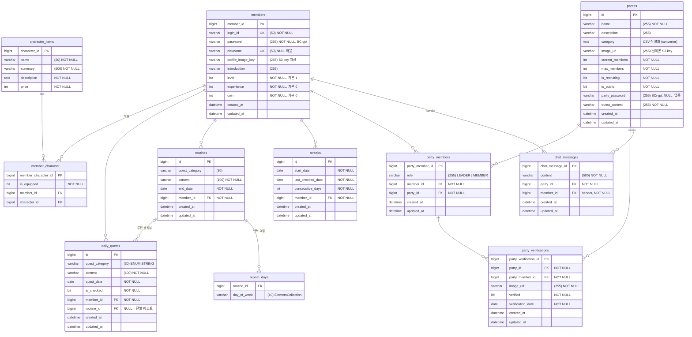

# ERD — 실제 코드 기준

> 엔티티 클래스와 로컬 MySQL(ddl-auto가 생성한 스키마, Phase 0에서 확인)을 기준으로 작성.
> README의 ERD 이미지와의 차이는 하단 대조표 참조.

## 고유 제약 (코드에 명시된 것)

| 테이블 | 제약 | 의미 |
|--------|------|------|
| members | `login_id` unique, `nickname` unique | 로그인 ID·닉네임 중복 방지 |
| daily_quests | unique(`routine_id`, `quest_date`) | 같은 루틴의 같은 날 퀘스트 1개 — 스케줄러 중복 실행 방어 |
| party_members | unique(`member_id`, `party_id`) | 중복 가입 방지 |
| party_verifications | unique(`party_member_id`, `verification_date`) | 하루 1회 인증 — 서비스 이중 체크의 최종 방어선 |
| member_character | unique(`member_id`, `character_id`) | 캐릭터 중복 보유 방지 |

## README ERD 이미지와 실제 구현의 차이

README의 ERD 이미지(2346×1219 PNG)를 판독해 전체 테이블·컬럼을 대조한 결과입니다.
**실제 코드를 기준으로 삼고, README ERD는 설계 당시 스냅샷으로 간주합니다.**

| # | 항목 | README ERD | 실제 코드 | 판정 |
|---|------|-----------|----------|------|
| 1 | routine의 `endDate` | **없음** | `end_date NOT NULL` — 루틴 전개·가상 캘린더의 핵심 컬럼 | **ERD 누락(중요)** |
| 2 | party의 `currentMembers` | **없음** | `current_members NOT NULL` — 가입/탈퇴 시 증감, 모집 상태 갱신에 사용 | **ERD 누락(중요)** — 사전 분석 R2와 직결 |
| 3 | repeatDays 표현 | routine의 `SET<DayOfWeek>` 단일 컬럼 | 별도 `repeat_days` 테이블(@ElementCollection) | 구조 다름 |
| 4 | party_verifications 컬럼 | id, createdAt, imageUrl, partyMemberId만 | + `party_id`, `verified`, `verification_date`, unique 제약 | ERD 누락 |
| 5 | members 프로필 이미지 | `profileImageUrl VARCHAR(500)` | `profile_image_key` — URL이 아니라 **S3 key** 저장 | 이름·의미 다름 |
| 6 | 테이블명 | daily_quest, routine, party, chat, party_quest_verification (단수) | daily_quests, routines, parties, chat_messages, party_verifications (복수) | 명명 불일치 |
| 7 | 길이 제약 | daily_quest.content 500, routine.content 500, nickname 30, introduction 500 | content 100, content 100, nickname 50, introduction 255 | 수치 불일치 |
| 8 | party.category | `SET<ENUM>` | `TEXT` + `CategoryListConverter`(CSV 문자열) | 구현 방식 다름 |
| 9 | 감사 컬럼 | chat·verification에만 createdAt 표기 | `BaseTimeEntity`로 대부분 테이블에 created_at/updated_at 존재 (CharacterItem, MemberCharacter 제외) | ERD 미표기 |
| 10 | party.name 길이 | VARCHAR(50) | 길이 미지정 → varchar(255) | 수치 불일치 |

결론: 관계 구조(FK 방향, 카디널리티)는 README ERD와 실제 코드가 일치하나, **컬럼 수준에서는 ERD가 구버전**입니다. 특히 #1, #2는 비즈니스 로직을 이해하는 데 필요한 컬럼이므로 본 문서의 ERD를 기준으로 사용해야 합니다.
