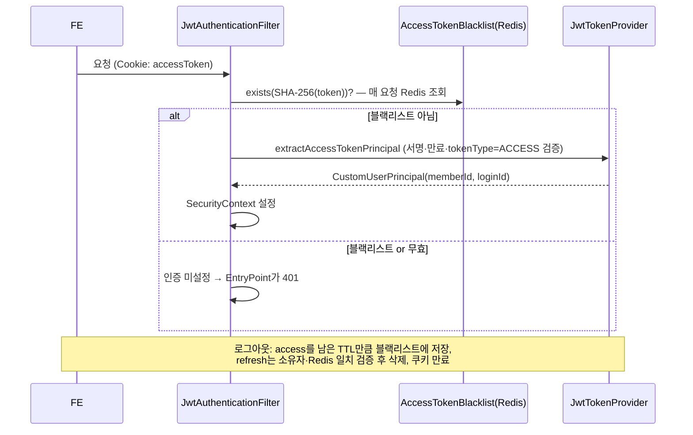
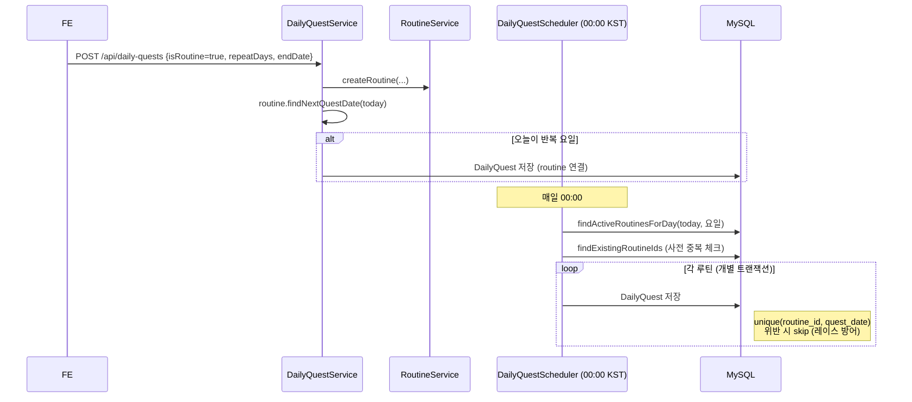
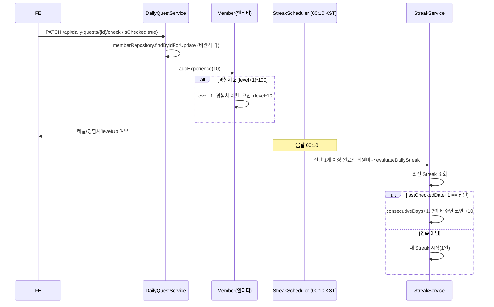
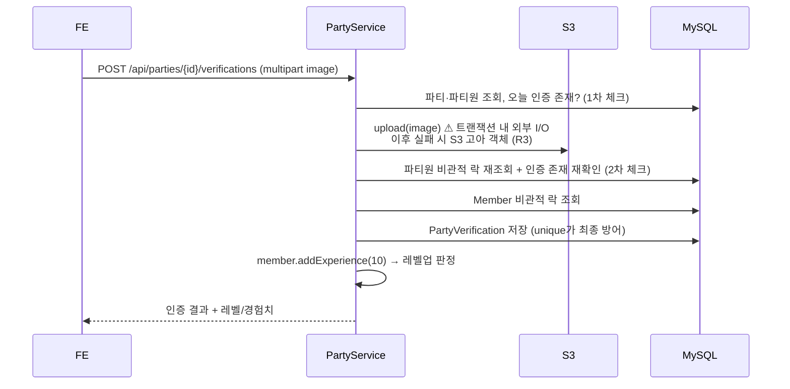
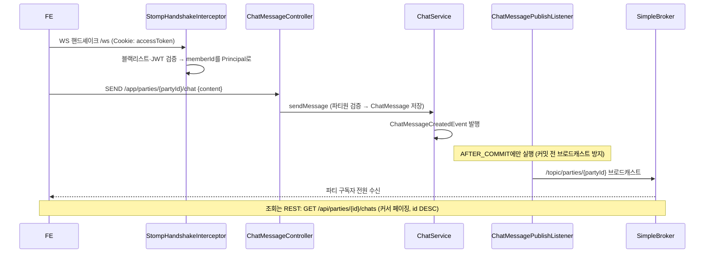

# 핵심 플로우 시퀀스 다이어그램

> 실제 코드 기준. 각 다이어그램 하단에 근거 파일을 명시.

## 1. 회원가입 → 토큰 발급

```mermaid
sequenceDiagram
    participant FE
    participant AuthController
    participant AuthService
    participant MemberRepo as MemberRepository
    participant CharRepo as CharacterItem/MemberCharacterRepository
    participant JWT as JwtTokenProvider
    participant Redis as RefreshTokenRepository(Redis)

    FE->>AuthController: POST /api/auth/signup {loginId, password}
    AuthController->>AuthService: signup(request)
    AuthService->>MemberRepo: existsByLoginId → 중복 시 DUPLICATE_LOGIN_ID
    AuthService->>MemberRepo: save(Member) (BCrypt 해시)
    AuthService->>CharRepo: findById(1L) 기본 캐릭터<br/>없으면 CHARACTER_NOT_FOUND ⚠ 시드 필수
    AuthService->>CharRepo: save(MemberCharacter, equip=true)
    AuthService->>JWT: issueTokens(member) → access(30분)/refresh(14일)
    AuthService->>Redis: save(memberId, SHA-256(refreshToken)) TTL 14일
    AuthController->>FE: 201 + Set-Cookie(accessToken, refreshToken; httpOnly)
```

근거: `AuthController`, `AuthService.signup`, `JwtTokenProvider`, `RefreshTokenRepository`, `CookieUtil`

## 2. 요청 인증 (JWT 필터) · 로그아웃



근거: `JwtAuthenticationFilter`, `AuthService.logout/blacklistAccessToken`

## 3. 루틴 퀘스트 생성 → 자정 스케줄러 전개



근거: `DailyQuestService.createRoutineQuests`, `DailyQuestScheduler`, `Routine`

## 4. 퀘스트 체크 → 경험치/레벨 → 다음날 스트릭 평가



근거: `DailyQuestService.checkDailyQuest`, `Member.addExperience`, `StreakScheduler`, `StreakService`

## 5. 파티 인증 (이미지 업로드 포함)



근거: `PartyService.createPartyVerification`

## 6. 실시간 채팅



근거: `WebSocketConfig`, `StompHandshakeInterceptor`, `ChatMessageController`, `ChatService`, `ChatMessagePublishListener`

## 관찰 요약

- 구독(`SUBSCRIBE /topic/parties/{id}`) 시점에 파티원 권한을 재검증하는 인터셉터는 **없음** — 핸드셰이크 시 회원 인증만 수행. 파티원이 아니어도 토픽 구독이 가능한지는 Phase 2 통합 테스트에서 검증할 것(잠재적 위험 후보).
- 스케줄러 2개는 단일 인스턴스 가정(분산 락 없음), 미실행 시 보정 로직 없음(R4).
